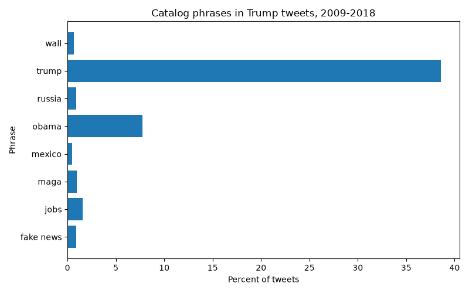

# [lab-web-data](https://csci40.rtealwitter.com/topics/05_web_scraping/lab.html)
# Web Data Lab

| phrase            | percent of tweets |
| ----------------- | ----------------- |
|         fake news | 00.88             |
|              jobs | 01.59             |
|              maga | 00.93             |
|            mexico | 00.45             |
|             obama | 07.73             |
|            russia | 00.91             |
|             trump | 38.58             |
|              wall | 00.68             |

"Trump" appears in about 39% of tweets, far more than any catalog phrase; I predicted "wall" would lead my chosen phrases, but "jobs" appeared most often (1.59%), ahead of "maga" (0.93%) and "wall" (0.68%).